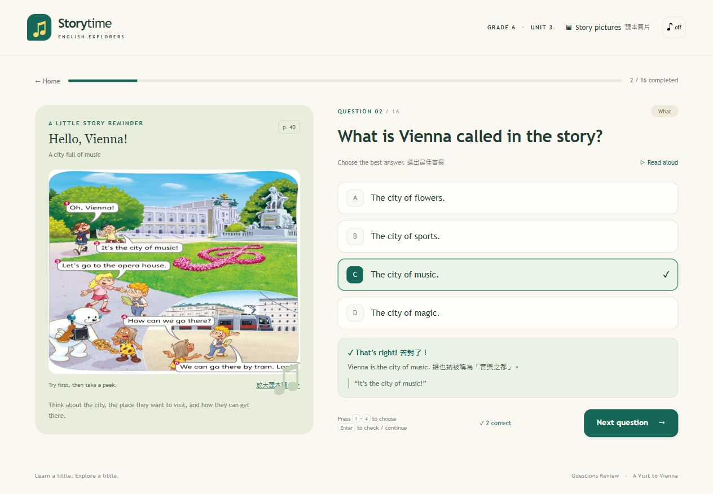

# A Visit to Vienna · Questions Review

小六英語 Unit 3 的互動式故事複習網頁，包含經老師確認的 16 題英文四選一題目。

## 直接使用

下載這個存放庫（Code → Download ZIP），解壓縮後，用 Chrome 或 Edge 開啟 index.html 即可。

網頁、樣式、程式與課本圖片都已包含在單一 HTML 檔中，作答及看圖不需要連線。英文朗讀依瀏覽器語音功能而定。

## 功能

- 16 題英文四選一，涵蓋 What、When、Who、Where、How。
- 選好答案後按 Check answer，顯示正解、簡短中英說明與故事線索。
- 六個課本情境圖，可選擇開啟提示及放大查看；第 16 題直接顯示看圖題圖片。
- 完成後顯示答對題數、正確率、全部題目解析與錯題篩選。
- 只重練答錯題目，或重新練習全部 16 題。
- 可選擇隨機題序、英文題目朗讀、作答音效。
- 支援手機與電腦；可用 1–4 鍵選答案，Enter 確認或繼續。
- 練習進度儲存在目前瀏覽器的 localStorage；不收集學生姓名或上傳成績。

## 編輯與重新產生網頁

修改 questions.js 可編輯題目、選項、答案與解析；答案使用 0–3 表示 A–D。

需要 Node.js 22.16 或更新版本，不需要安裝其他套件：

    node build.mjs
    node verify.mjs

build.mjs 會把來源檔案與圖片合併到根目錄的 index.html。

| 檔案 | 用途 |
| --- | --- |
| index.html | 可直接使用的完整離線網頁 |
| questions.js | 16 題題庫、答案與情境資料 |
| app.js | 網頁互動及介面 |
| core.js | 作答、計分及錯題重練邏輯 |
| style.css | 電腦與手機版面樣式 |
| index.template.html | 網頁結構範本 |
| assets/ | 從老師提供課本截圖裁切的情境圖 |
| verify.mjs | 題庫、答案、計分、續作及離線封裝檢查 |

## 圖片來源

情境圖來自老師提供的 Unit 3 課本第 40–43 頁截圖，為本次教學複習裁切使用；課本插圖的權利仍屬原權利人。
